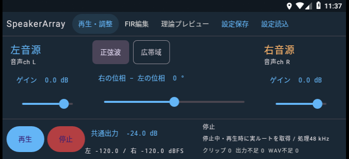
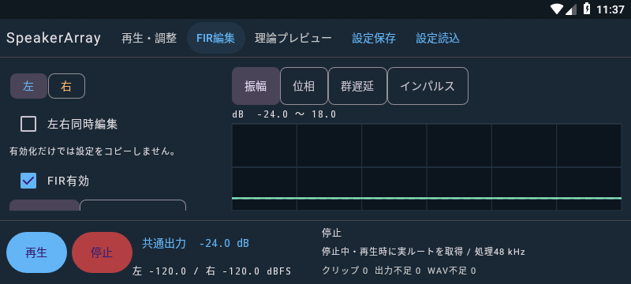
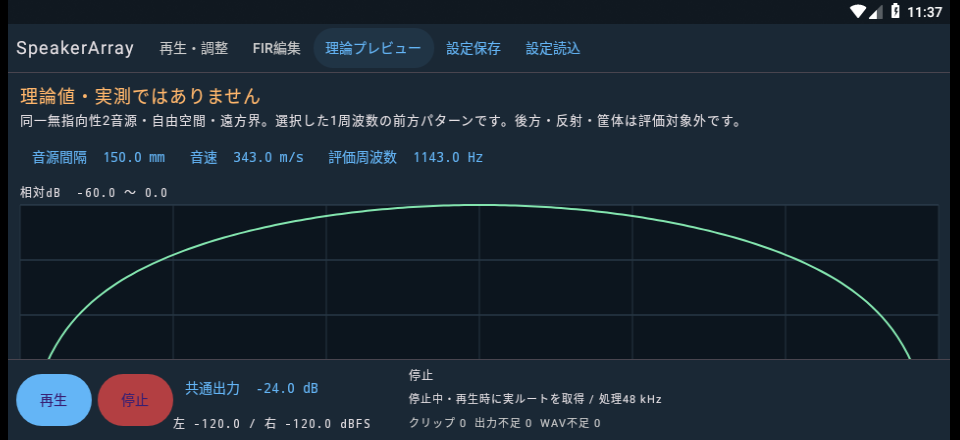
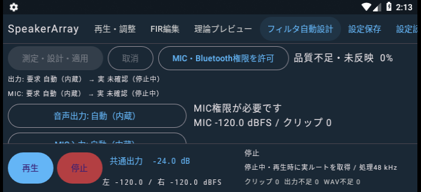
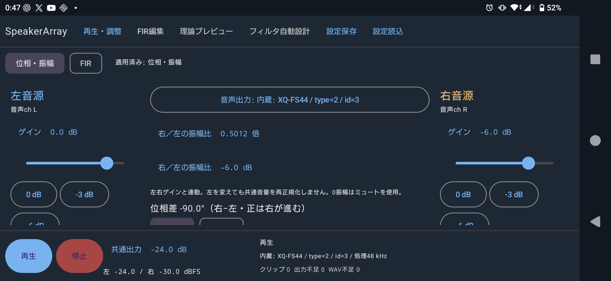

# 検証記録

検証日は2026-11-06です。ホストはWindows、JDK 17.0.11、Android SDK 34、Gradle 8.7です。作業ブランチは`feat/android-speaker-array`で、mainへのpush・マージは行っていません。

## 自動検証

`./gradlew :core:test`で29テストが成功しました。DSPテスト20件、WAV・設定形式テスト9件です。`./gradlew :app:assembleDebug :app:lintDebug`でデバッグAPKの生成とAndroid Lintを確認しました。Lintの残る警告は、環境に合わせて固定した依存ライブラリに新しいバージョンがあるという通知です。

| 対象 | 確認内容と結果 |
| --- | --- |
| FFT・畳み込み | FFT往復、1025タップのインパルス応答、ブロック境界、フラットとバイパスの遅延一致が成功 |
| 音源・左右処理 | 同一サンプル列、正弦波の周波数・90°差、ゲイン比、極性、ミュート、最終ch交換が成功 |
| 遅延 | 正負・0・整数境界・端数・最大値、理論整合方向の符号が成功 |
| FIR設計 | LPFの通過域・阻止域・遮断境界、EQの+6 dB、対称性、任意係数の振幅保持が成功 |
| 切替 | 入力履歴の保持、途中での再編集、最新世代の適用、有限値維持が成功 |
| 応答表示 | 非対称FIRの群遅延、深い零点の非表示、1025タップの高域位相unwrapが成功 |
| 理論 | 同相正面0 dB、逆相正面−60 dB、d=0、片側ミュート、非対称FIR、固定参照が成功 |
| WAV | PCM16/24/32・float32、mono/stereo、24-bit符号、追加チャンク、奇数長パディング、シーク、短いループが成功 |
| ファイル形式 | JSON往復、未知のバージョン・レート・種別、CSVの列数、非有限係数、破損WAVの拒否が成功 |
| AudioTrack書込 | 短い書込でもインターリーブ順を保持し、エラー・繰り返す0戻り値を検出 |

### 補間遅延の誤差

100 Hz刻みで応答を計算し、遅延0、0.001、0.048、0.25、0.5、0.95、0.999、1、1.001、21、479.9、480サンプルを確認しました。振幅1、位相`−2πf(16+delay)/48000`を基準にしています。

| 帯域 | 最大振幅誤差 | 最大位相誤差 |
| --- | ---: | ---: |
| 100 Hz〜8 kHz | 0.0000909 dB | 0.001146° |
| 100 Hz〜20 kHz | 0.005814 dB | 0.022326° |

指定された100 Hz〜8 kHzの目標である0.2 dB・1°以内を満たしました。離散的な検証点の結果であり、連続する全周波数・全遅延値の厳密な最大誤差や端末ハードウェアの精度を保証するものではありません。

### リサンプリング

44.1→48 kHzの1 kHz・振幅0.5の正弦波では、端部を除く最大サンプル誤差が0.0000557でした。192→48 kHzで40 kHzの正弦波を入力したときの折り返し成分RMSは0.00000489でした。48 kHzのWAVはリサンプリングせず、元のPCM値を保持します。

### 処理負荷

ホストJVMでは1025タップ・2chの切替を含む500ブロックを約86 msで処理しました。音声時間は2666.7 msです。この数値はAndroid端末の負荷保証には使いません。

Android 8.1のx86エミュレータでも1025タップ・2chを再生しながら遅延を10回切り替えました。最終実行時の表示値はブロック最大負荷16.87%、出力バッファ不足0、クリップ0でした。短時間のエミュレータ試験であり、実機の長時間運用・熱制限・バックグラウンド負荷は未検証です。

## UIとライフサイクル

`AppTest`の4テストでEQドラッグ、手動反映、200 ms自動反映、左右同時編集を確認しました。左右同時編集を有効にしただけでは既存設定を変えず、自動反映をOFFにした後に予約済みの編集が適用されないことも確認済みです。

再生中のタブ変更とActivity再作成で音声スレッドが1本のままであること、バックグラウンド移行後に0本になることを確認しました。数値入力中のダイアログにも停止ボタンが表示されます。音声フォーカスを別の要求へ移した場合は停止し、フォーカスを返しても自動再開しません。

700×320、800×360、960×440ピクセル・160 dpiのテスト画面で、3タブの常設停止ボタンを確認しました。Androidのステータスバーを除くアプリ領域はそれぞれ700×296、800×336、960×416 dpです。フォント倍率1.3と画面再作成も確認しました。幅の狭い表示では中央領域が縦並びになります。

古いエミュレータで物理密度440 dpiから160 dpiへ切り替えた際、スクリーンショットの縮尺が崩れたため、物理密度160 dpiのテスト用AVDを別に作成して再取得しました。最終画像は`docs/screenshots/`に保存しています。







## 実機で行う確認

初期実装時点では実機での音響測定と性能評価は未実施でした。自動設計追加後の測定結果は後述します。以下は端末での確認手順です。

1. 端末本体の音量とアプリの共通出力を低くし、横置きの向きを固定します。片側再生で物理左右を確認して割り当てます。
2. 正弦波の位相、左右ゲイン、極性、ミュートを変更し、割り当てた側と操作対象が一致するか確認します。OSのモノラル音声・音質補正などの設定も記録します。
3. 1025タップで10分以上再生し、EQ・係数・遅延を繰り返し変更します。画面の処理負荷、出力不足、WAV不足、クリップ回数と端末温度を記録します。
4. USB・イヤホン・Bluetoothへの経路変更で停止し、左右の再確認が必要になるか確認します。通話、他アプリの再生、ホーム画面移動から勝手に再開しないことも確認します。
5. 縦画面、小ウィンドウ、切欠き、画面拡大、IME表示で停止操作に到達できるか確認します。最新Androidの向き制限の上書きも対象です。
6. SAFで各形式のWAVとFIRを読み込み、保存したセッションを再起動後に復元します。URI権限の取消・ファイル移動時は停止したまま再選択できるか確認します。
7. 音圧・位相・指向性は別の計測器で評価します。測定距離、端末音量、反射条件を記録し、理論グラフを実測の代わりにしません。

初期実装時点では、物理スピーカーの独立性、OSの音声加工、実DACレート、経路変更の機種差、長時間の熱・性能、SAFプロバイダー間の差、切欠き付き実機、API 26実機および新しいAndroid OSは未確認でした。GitHub Actionsもファイルを作成した段階で、リモート実行はしていませんでした。

## フィルタ自動設計の追加検証（2026-11-06）

SpeakerArrayの最新ローカル差分を維持し、周波数の自動追従、左右ゲインのセットボタン、−90°位相ボタンを含めて機能を追加しました。作業開始時のブランチは`feat/android-speaker-array`で、HEADは`f27636498198486af370c3fd33900d8c3ffbbdcd`でした。指定SHAへの巻き戻しは行っていません。

### JVMとAndroidの検証

追加した合成テストでは、左右ゲイン・相対遅延・反射を持つ伝達特性から、基準側を非ゼロに保った因果FIRを設計し、残差が低下することを確認しました。大きな共通遅延、100 ppmの滑らかなクロック差、異なる入力レートの補間、独立ピーク整列による相対遅延の消失、遅延ジャンプ、フレーム欠落、帯域欠落、ゲイン変動、位相変動、深い零点、クリップ、無信号も検証対象です。

保存形式では旧セッションの移行、任意係数の保持、元のFIR長・手動調整・A/Bの復元、取消後および古い世代の反映拒否を確認しています。元のDSP・WAV・ファイル形式のテストも実行しています。これらは合成データとソフトウェア状態の検証であり、音響性能の実証ではありません。

Androidの回帰確認には音声出力を無効にしたAPI 27の専用エミュレータを使用しました。既存の再生更新、フォーカス喪失、バックグラウンド停止、手動FIR編集に加え、自動設計の権限拒否と開始直後の取消を検証しました。開始直後の取消テストで終了処理が中断される問題を検出し、診断保存・音声解放・実行中フラグの解除を1つの取消不能な終了処理にまとめました。

JVMテストは47件、AndroidのAppTestは5件が成功しました。debug APKとテストAPKのビルド、lintDebugも成功しています。lintはエラー0件で、依存関係の新バージョン通知が5件ありました。700×320、800×360、960×440ピクセルの全4タブを確認し、自動設計画面では開始・取消・停止と要求／実ルートを常時表示しています。



### XQ-FS44とTechnics EAH-AZ100での測定

ユーザーが左右の割当とMICの固定を確認した後、WiFi ADB接続中のXQ-FS44で測定しました。Androidの入力端点名はXQ-FS44と報告されましたが、種別はBluetooth SCOです。接続ヘッドセット名は端末の音声診断でTechnics EAH-AZ100と確認しています。

内蔵スピーカー出力とHFP MIC入力について、要求デバイスとストリーム開始後の実デバイスの一致を確認しました。アプリ側PCMは出力48 kHz・2ch float、入力48 kHz・1ch PCM16です。通信コーデックは取得していないため不明です。PCMが48 kHzであることから音響帯域を推定していません。

| 条件 | 最大同期残差、48 kHz換算 | 結果 |
|---|---:|---|
| VOICE_RECOGNITION、アプリ−24 dB | 12.9906サンプル、約0.2706 ms | 品質不足・未反映 |
| VOICE_COMMUNICATION、アプリ−24 dB | 14.7873サンプル、約0.3081 ms | 品質不足・未反映 |
| ユーザーが端末音量を上げ、VOICE_COMMUNICATION、アプリ−18 dB | 1.2233サンプル、約0.0255 ms | 品質不足・未反映 |
| 端末音量は前回のまま、VOICE_COMMUNICATION、アプリ−12 dB | 1.2725サンプル、約0.0265 ms | 品質不足・未反映 |

いずれも300〜3,400 Hz、各スイープ3秒、左右2回、残響保持0.5秒、同期探索余裕1.5秒です。入力クリップは0件でした。AndroidのNS・AECは無効化の成功を確認し、AGCは公開エフェクトAPIが非対応でした。ヘッドセット内部の音声処理を解除できたことは確認していません。

2回目の線形時刻推定では共通オフセットが12,382.2028サンプル、クロック差が約9.9692 ppmでした。音量を上げた3回目ではオフセットが12,625.2967サンプル、クロック差が約−0.3843 ppmでした。これらは録音開始と出力開始の差も含む推定値で、Bluetoothだけの通信遅延ではありません。

信号を強くした3回目では同期残差が減りました。信号の弱さが初回の残差に関与した可能性がありますが、端末側とアプリ側の音量を同時に変更したため、各要因を分離した比較ではありません。4回目の−12 dBではクロック差が約−0.4196 ppm、入力クリップは0件でしたが、同期残差は−18 dBと同程度でした。今回の比較では、さらに6 dB上げても同期精度の改善を確認できませんでした。

全4回が実装基準の0.35サンプルを超えたため、周波数別品質判定・FIR設計・効果確認へは進めていません。有効帯域と打消し効果は未確認です。この同期上限は指示書の指定値ではなく、実装時に置いた保守的な値です。検出誤差と実際の遅延変動を分離できていないため、診断の継続と正式反映の判定を分ける余地があります。今回の測定結果を通すための基準変更はしていません。

測定後はMODE_NORMALとSCO_STATE_INACTIVEへの復帰を確認しました。比較測定用テストで、音量復元後の保存完了前にActivityを終了する問題が見つかったため、保存を待つよう修正しました。最終的に元の−24 dBへ戻して保存を確認しています。ユーザーが設定した端末音量には変更を加えていません。測定失敗を理由に元のFIR・左右ゲイン・位相・遅延を置き換えることもしていません。

### 未検証の範囲

USB／有線／内蔵MICを使った実音響測定、API 26〜30実機でのSCO確立、HFP補正の正式反映後に録音・通信経路を保持した通常再生、全進行段階での実デバイス切断・フォーカス喪失は未検証です。エミュレータでの停止や合成データの合格を、これらの実機検証の代わりにはしていません。実機で正式反映に至る品質を得られていないため、GUI・再生・保存までを含む成功経路の音響実証も未完了です。

### RFMonitorの参照範囲

参照したローカルHEADは`42604b8ea820cc439988ee006a3987d72812d0ae`で、作業開始時のGit差分はありませんでした。`AudioDeviceRouter.java`、`EndpointPreference.java`、`PlaybackEngine.java`、`CaptureSource.java`、`CommunicationEngine.java`、`docs/ANDROID_11_AUDIO_ROUTING.md`を読み取りで参照しました。RFMonitorではビルド、テスト、ファイル編集、Git状態を変更する操作を行っていません。開始時と終了時のHEAD・Git差分・追跡ファイルおよび未追跡ファイル256件のSHA-256を照合し、すべて一致しました。

ローカルの生ログと照合データはSpeakerArrayの無視対象`build/autofir-audit/`に保存しています。生のMIC録音は保存していません。再測定用の`HfpDeviceTest`は明示的な実機測定フラグがある場合だけ動作し、通常のテストではスキップします。


## 実用化に向けた追加改修（2026-11-06〜07）

対象は`feat/android-speaker-array`の`b50f5580817208e55b85c3d66d1f9a8b375c2817`です。開始時の作業ツリーに差分はなく、巻き戻しはしていません。今回の実装と検証結果を以下に記録します。ユーザーの依頼により、この記録を含む変更をコミットし、同ブランチへpushします。

### 実装と判定の変更

同期残差0.35 sampleによる停止を廃止し、警告、診断継続、試験適用、正式反映を分けました。各測定の前後に置く同一基準chのパイロットから共通時間軸を求め、相関係数と競合ピークも保存します。外れ値は除外しません。左右同一応答は警告とし、非ゼロ基準chを保った設計を続けます。

SNR 20 dB、反復振幅差1 dB、反復位相差5°、有効ビン80%、両基準に対する3 dB改善、部分帯域の悪化3 dB以内は維持しました。合格したビンと重みを補正前に固定し、前後基準または両側基準がそのビンで品質を失った場合は拒否します。対数スイープ等の設計信号と、固定シードの帯域制限ノイズを、それぞれ同じ信号内で2回比較します。

同期には最小6点・2秒以上、共通テンプレートとの相関係数0.65以上、中心ローブ外の競合ピーク比0.9以下を要求します。0.12未満は識別不能です。要求上端の1/4周期を超える偏差は未解決として扱い、各側3点以上の段差モデルで持続する不連続を確認できた場合だけ中止します。段差モデルの誤差は段差量の20%未満、直線モデル最大残差の25%未満を条件としています。これらは仮の0.35 sampleを実機結果が通る値へ置き換えたものではありません。粗い時間軸異常と相関の曖昧さを検出し、細かい品質は周波数別反復性で判定します。

採用した16倍の窓付きsinc相関補間は、ピーク位置を1/16 sampleの格子で探索します。共通録音テンプレートを要求帯域に制限し、理想信号と録音経路の周波数特性の違いを抑えています。合成した帯域制限・反射・端数遅延・80 ppmクロック差では、旧方式と同じ理想テンプレートでも新しい共通テンプレートでも安定した時刻モデルを得ました。この条件で残差が小さくなったとは主張していません。実機で確認できた改善は、旧基準を超えても同期の信頼度を保存して下流品質まで評価できることです。

成功・失敗とも診断JSONスキーマ2を使います。4097ビンの複素応答、SNR、左右別の反復差、無効理由、固定マスク、パイロット情報、測定順序、経路・音量、FIR、反復ごとの効果を保存します。未評価値はnullまたは項目の欠如で表します。通常再生には測定と同じAudioTrackを使い、係数・モード・音量の一致とPCMピークを検査します。再起動後は保存結果を表示しますが、測定経路を維持しているとは表示しません。

### ソフトウェア検証

JVMテスト58件、API 27の専用エミュレータでAndroidテスト7件が成功しました。`:core:test :app:assembleDebug :app:assembleDebugAndroidTest :app:lintDebug`も成功しています。Lintはエラー0件、依存関係の新バージョン通知5件です。実機で保存診断を再表示する無音テストも成功しました。

実パイロット波形に350〜1,800 Hzの帯域制限、反射、端数遅延、雑音、80 ppmクロック差を加え、検出から判定まで通しました。パイロット区間に700 Hzの干渉音を加えた安定クロックの例では、検出残差1.0201 sample、最小相関約0.7533で診断を継続します。下流の安定した応答では候補を設計でき、反復位相差が悪い応答では拒否しました。既知の時刻値を直接ずらすだけのテストにはしていません。

実波形の48 sampleの段差、160 sampleの欠落相当、強い競合反射、AGC相当のゲイン変動、ゲート、スイープ途中の欠落は拒否されました。同期が安定して見える場合でも、下流品質でゲートや欠落を検出できる例を含めています。あらゆるHFP処理や欠落を検出できる保証ではありません。

対称な左右応答は警告付きで設計でき、相対音響遅延を持つ系では既存の遅延保持テストも成功しています。実際のDspEngineを通した候補を合成音響系へ入力し、スイープと帯域制限ノイズの両方で、各2回の低減判定が成功しました。これはソフトウェア上の成功経路の検証です。

Androidでは測定用ストリームの通常再生への引継ぎ、同じ実ルートの維持、係数変更時の停止、停止後の再生、経路解放を確認しました。失敗診断の全解像度JSON、権限拒否、取消、既存のFIR編集・再生・画面サイズ・バックグラウンド停止も対象です。エミュレータは音声出力を無効にしており、音響効果の実証には使っていません。

### 準備確認後のHFP実機測定

XQ-FS44、Technics EAH-AZ100、内蔵スピーカーtype=2／id=3、HFP MIC type=7／id=331で測定しました。要求・実ルートは一致しています。VOICE_COMMUNICATION、出力48 kHz stereo float、入力48 kHz mono PCM16、共通出力−24 dBです。測定中のSTREAM_MUSIC音量インデックスは30でした。端末本体の音量は変更していません。NSとAECは公開APIで無効化でき、AGC APIは非対応、ヘッドセット内部の処理と通信コーデックは不明です。

ユーザーから設置が不十分だった可能性を指摘されたため、準備完了の返答後に300〜3,400 Hzを1回測り直しました。その後、ユーザーの明示承認で要求帯域だけを500〜1,000 Hzへ変更し、独立した3セッションを実施しました。左右割当、MIC固定、静音の確認を得てから開始を予告しています。

| 要求帯域・セッション | 最大残差 sample | SNR中央値 左／右 dB | 反復位相差中央値 左／右 | 有効ビン率 | 結果 |
|---|---:|---:|---:|---:|---|
| 300〜3,400 Hz、準備確認後1回目 | 1.3388 | 27.66／25.16 | 13.55°／13.19° | 0.76% | 品質不足・未反映 |
| 500〜1,000 Hz、1回目 | 1.3244 | 31.13／28.48 | 11.03°／5.21° | 4.71% | 品質不足・未反映 |
| 500〜1,000 Hz、2回目 | 1.4801 | 28.16／25.99 | 16.14°／2.56° | 1.18% | 品質不足・未反映 |
| 500〜1,000 Hz、3回目 | 1.2206 | 29.64／26.55 | 7.61°／8.71° | 0.00% | 品質不足・未反映 |

中央値は傾向を示す集計値です。判定は各ビンで左右のSNRと反復振幅・位相の全条件を評価しており、中央値だけで合否を決めていません。全回で入力クリップは0件でした。同期残差が旧基準を超えても、警告として下流解析を継続しました。20ビン以上連続する有効帯域は得られず、試験適用には進んでいません。片側比・両側比の実測低減量、別信号の実機低減、通常再生の実機低減はすべて未評価です。正式反映条件を満たしたセッションは0/3で、実用確認済みの条件はありません。

300〜3,400 Hzの準備確認後データでは、反復位相差を遅延へ換算すると左右とも約0.9 sampleでした。一方、前後パイロット残差から推定した変化は左−0.62 sample、右0.85 sampleで、左側は一致しませんでした。パイロットごとの時刻へ強制整列して反復差を消す補正は採用していません。HFP内部処理、スイープ途中の時間変動、波形の検出誤差をこのデータだけで分離できていません。

### 準備確認前の参考記録

以下は設定準備の不足があった可能性があるため、HFP性能の判断や準備確認後との厳密な比較には使いません。失敗した測定も記録として残しています。

| 共通出力・セッション | 最大残差 sample | 有効ビン率 | 結果 |
|---|---:|---:|---|
| −24 dB、1回目 | 1.2538 | 3.02% | 品質不足・未反映 |
| −18 dB、1回目 | 1.1123 | 0.00% | 品質不足・未反映 |
| −18 dB、2回目 | 1.3197 | 2.46% | 品質不足・未反映 |
| −18 dB、3回目 | 1.2874 | 0.00% | 品質不足・未反映 |

### 導入・復元・残る制限

最新版をWiFi ADBの`192.168.0.28:43815`へ更新インストールしました。アプリデータを消す再インストールは行っていません。APKは`app/build/outputs/apk/debug/app-debug.apk`です。測定後は共通出力−24 dB、MODE_NORMAL、SCO_STATE_INACTIVEを確認しました。A/Bは保持され、補正係数の正式反映はありません。作業中に音源SWEEP→SINE、右ch極性反転ON→OFFの変更があり、ユーザーの手動変更との確認を得たため、その状態を保持しています。要求帯域は承認された500〜1,000 Hzのままです。

最終版でも保存診断を開く無音テストは成功しました。ただし、最終撮影時は端末がロック・消灯状態に戻り、表示を撮影できませんでした。黒画面の画像は記録に含めていません。最終版の画面操作とサイズ別表示はエミュレータの回帰テストで確認しています。

診断継続、同期の信頼度評価、候補の検証、保存・復元、GUIは実装し、関連テストを通しました。一方、準備確認後のHFPでも有効帯域と反復性が成立していません。実機での正式反映、独立3セッションの成功、別信号と通常再生での低減効果、正式反映後の実機での元に戻す・再適用は未達です。USB／有線入力にも同じ処理を使用できますが、今回それらの機器は接続していません。ユーザーの希望に従いHFP入力を維持し、別入力へ自動切替していません。

RFMonitorは今回も読み取り専用とし、開始・終了のHEAD、Git差分、256ファイルのSHA-256が一致しました。SpeakerArrayの無視対象`build/practical-audit/`に設定スナップショット、全回の診断JSON、照合結果を保存しています。生のMIC録音は保存せず、監査ファイルをGitへ追加していません。

Android APIの参照先は[AudioRecord.getTimestamp](https://developer.android.com/reference/android/media/AudioRecord#getTimestamp(android.media.AudioTimestamp,%20int))と[UiAutomation](https://developer.android.com/reference/android/app/UiAutomation)です。取得可能なフレーム時刻を診断に使用し、実機テストの画面確認は音声を出さずに実行しました。


## BT出力制限と補正方式切替（2026-11-07）

開始時のHEADは`18dcae07d87b9f96e9a55df6d22e82bba19daea6`、ブランチは`feat/android-speaker-array`です。開始時の作業ツリーはクリーンでした。当該記録作成時点では変更がローカル作業ツリーにあり、コミット・pushは未実施でした。その後、`6e92ecc`としてコミット・push済みです。

### 操作と保存

「再生・調整」上部の「位相・振幅」「FIR」で切り替えます。右／左の振幅比は線形比とdBで入力でき、左右ゲインと連動します。位相は右−左で正が右の進み、遅延は右−左で正が右の遅れです。広帯域では基準周波数における位相と遅延を併記します。正弦波から広帯域への変更時は等価遅延への変換を案内し、元の正弦波設定を保持します。

FIRの係数と手動調整、単純補正の設定、方式、A/B、校正プロファイルを独立して保存します。一時ソロは保存値を変更しません。旧バージョン1・2の設定はFIR側にそのまま復元し、現在の音を維持します。バージョン3では全配列を持つ校正結果とA/Bを扱うため、セッション読込上限を6400万文字へ広げました。FIR単体の200万文字制限は維持しています。

BTメディア出力時は本体MIC・アナログ有線MIC・USB MICだけを選択可能とし、BT入力と未知の入力は理由付きで無効にします。既存のBT MIC設定は保持し、入力を選び直すまで開始できません。通常再生はMICを要求せず、出力設定を自動設計と共用します。

### 自動テスト

JVMテストは既存58件と追加11件の計69件が成功しました。追加したテストでは、SCO・LEを含むBT入力制限、不適合JSONの保持、旧形式移行、方式往復、A/Bの両設定、単純補正でのFIR除去、正弦波の位相・振幅比・左右交換、複数周波数での遅延位相、極性との区別、変換範囲超過、保存と未検証表示、外部配置の分離を確認しています。

実際のSourceEngineとDspEngineを通す正弦波テストでは、右−6 dB、発振器位相+90°、右遅延125 µs、1,000 Hzの出力から振幅比と位相差+45°を確認しました。左右交換後は比の逆数と−45°になります。連続要求では同じ発振器と入力履歴を保ち、最後の世代へ収束しました。共通出力−20 dB、1,000 Hzの試験で最大隣接サンプル差0.015未満、クリップ0件を確認しています。この数値は実機での聴感上の無音切替を保証する値ではありません。

音声出力を無効にしたAPI 27エミュレータでは、既存5件、追加3件、保持ストリーム等2件の計10件が成功しました。方式を連打しても同じ音声スレッドを維持し、WAVの同じ読込オブジェクトと再生位置が継続します。保持した測定ストリームでもFIR→位相・振幅→FIRを往復し、通信条件を維持しました。取消直後の遅延進捗通知が終了状態を上書きする不具合を検出し、終了済み測定の通知を無視するよう修正しています。

ビルドと`:app:lintDebug`も成功しました。Lintはエラー0件、依存関係の更新通知5件です。エミュレータでは、組合せポリシーと未接続設定からの開始拒否を検証しています。BT出力機器の接続やフォールバックを物理的に再現する試験は行っていません。

### 本体スピーカーでの確認

ユーザーの許可後、XQ-FS44の内蔵スピーカーtype=2／id=3で切替再生を行いました。共通出力は−24 dB、同じ正弦波・同じ端末音量です。FIR側にはフラット係数・右−6 dB・位相0°、単純補正側には右−6 dB・位相−90°の一時設定を使いました。AutoFIRの合格係数による比較ではありません。

初回は同じ端点の表示が取得タイミングで別形式になり、文字列による経路照合でテストが停止しました。経路名を種別・ID付きの同じ形式へ統一した後、約20秒の再確認が成功しました。

| 順序 | 適用方式 | 適用世代 | クリップ | 出力不足 |
|---|---|---:|---:|---:|
| 1 | 位相・振幅 | 3 | 0 | 0 |
| 2 | FIR | 4 | 0 | 0 |
| 3 | 位相・振幅 | 5 | 0 | 0 |
| 4 | FIR | 6 | 0 | 0 |
| 5 | 位相・振幅 | 7 | 0 | 0 |

全区間で同じ出力端点と同じ音声スレッドを確認しました。終了後は停止し、元のセッションと保存内容が一致することを検査しました。元の共通出力−24 dB、SINE、右極性反転OFF、要求帯域500〜1,000 Hz、左右ゲイン、A/Bを保持しています。旧形式の既存フィールドも移行前後で一致しました。



最新版はWiFi ADBの既知端末`192.168.0.28:43815`へ更新インストールしました。APKは`app/build/outputs/apk/debug/app-debug.apk`です。生のMIC録音は取得していません。

### 未検証の範囲と参照先

今回の実機確認は通常再生の方式切替です。クリックの聴感評価、MICでの低減量、FIRと単純補正の優劣を測定したものではありません。前回のHFP AutoFIRは正式反映0/3のままで、測定合格後の実機HFP保持状態での比較は未確認です。

A2DP／LE出力での通常再生、自動設計、実機でのBT切断・再接続やBT入力へのフォールバック、USB／有線MICとの同時使用は未検証です。ユーザーが今回許可した本体スピーカーの試験に限定し、BT出力機器へ勝手に切り替えていません。

RFMonitorにはファイル操作、ビルド、テスト、Git状態を変更する操作を行っていません。前回記録の256ファイルはすべてSHA-256が一致し、HEADとGit状態も一致しました。今回の一覧には別途1ファイルが増えていますが、この作業で作成したものではありません。SpeakerArrayの設定控え・テストログは無視対象`build/switch-audit/`に保存しています。


## 保存診断分析・単一周波数自動調整・FIR試験判定（2026-11-07）

今回のユーザー指定に従い、実機へのインストール、実機操作、音響実証は実施していません。以前の節にある実機インストール・切替再生は前回の記録です。今回のAPKは未導入です。ブランチ`feat/android-speaker-array`とHEAD`18dcae07d87b9f96e9a55df6d22e82bba19daea6`を維持し、前回の未コミット変更へ追加しました。当該記録作成時点ではコミット・pushは未実施でした。その後、`6e92ecc`としてコミット・push済みです。

### 保存JSONの分析

8セッションを同じスクリプトで再集計しました。準備前4回と準備後4回を区別し、準備後500〜1,000 Hzの3回を主評価としています。厳密条件の有効率は4.71%、1.18%、0.00%、試験案20 dB・2 dB・20°では78.82%、60.00%、74.12%でした。3 dB・20°へ変えても、この3回の有効率は変わりません。全8回で試験案80%以上は0回です。

主評価3回の保存JSONでは`timing.reliable=false`で、`PILOT_AMBIGUOUS`が残っています。旧0.35 sample超過を警告にしたことと、同期の信頼度が成立したことは区別します。今回の再集計でも過去の測定結果を試験可能・実測成功へ変更していません。

左右別の分布、失敗理由の単独率と重複、位相の傾きと残差、振幅の帯域依存、L/R比、全閾値の連続帯域、反復を分けた予測は[解析レポート](auto-adjustment-analysis.md)と、そのリンク先に記載しました。予測は有限長FIRの実測効果ではなく、生PCMの再解析でもありません。

### 実装とテスト

単一周波数方式は広帯域の反復位相判定から独立し、基準ch固定・補正chの位相とゲイン探索・新しい録音での逆順再検証を実装しました。出力と録音を連続させ、開始時の立上り／消失と候補ごとの整定を確認します。下限でも双方の基準から3 dB以上を2回満たす場合だけ、単純補正へ反映します。失敗・取消では元のセッションを保持します。

FIRは厳密診断`strict-complex-v1`と試験判定`trial-power-v1`を分けました。後段の固定マスクにも試験判定を明示し、前後基準・反復候補・ノイズを使う保守的な電力比較を追加しています。旧5°の条件を隠して残すことも、既知の時刻異常を無効化することもありません。

保存形式4で単一周波数の条件・結果を保持し、形式1〜3を読み込みます。FIR／単純補正、A/B、元に戻す、再起動後の表示を確認しています。検証済み表示は、保持中の音声経路に対応するプロファイルに限定しました。別方式で経路を作り直したり、再起動したりした後に、以前の結果を検証済みとして表示しません。

| 検証 | 結果 |
|---|---|
| JVM | 80件成功。既存69件＋単一周波数・判定・形式3移行11件 |
| Python分析 | 2件成功。理由集計・閾値境界・低SNR区間・位相折返し |
| Android | 音声無効のAPI 27エミュレーターで計14件成功。既存UI5件、補正方式3件、保持ストリーム・診断3件、単一周波数UI／取消／保存／無信号3件 |
| APK | `:app:assembleDebug`と`:app:assembleDebugAndroidTest`成功 |
| Lint | エラー0件、依存更新通知5件 |

合成2経路では既知の最小点付近を探索し、候補選択に使っていない測定で再確認しました。3.217秒の固定遅延、非整数周期、±200 ppm、DC、別周波数成分を加えたPCMでも電力を確認しています。古い取得範囲、待ち時間不足、整定中、ノイズ床、基準ドリフト、順序依存、クリップ、非有限PCM、経路切断は合格にしない試験を追加しました。基準ゼロや両ch共通減衰の解を作らず、右基準でも右／左・右−左表記へ変換します。

エミュレーターでは単純補正だけの測定保持ストリームでも通常再生と方式往復ができ、解放すると停止することを確認しました。音声無効時の無信号測定は反映されず、出力・録音スレッドを解放します。横置きの単一周波数画面でも常設停止と主操作が表示されることを確認しています。

テスト中、録音権限をテスト自身が取り消したためAndroidがプロセスを終了させました。権限解除をホスト側のテスト終了後へ移しています。また、方式クリック直後の状態を待たずに検査する競合を直し、再実行で成功しました。これらはテスト手順の修正で、失敗を成功件数へ含めていません。

### 成果物と未実証の範囲

APKは`app/build/outputs/apk/debug/app-debug.apk`です。実機の単一周波数低減、広帯域FIR低減、BT出力検証はすべて今回未実施で、新しい実測の周波数・ゲイン・位相・低減量・ばらつき・成功回数はありません。ソフトウェア試験を音響低減の証明として扱いません。

RFMonitorは読み取りだけで照合しました。開始・終了でHEAD、Git状態、257ファイルのSHA-256が一致し、変更・生成・ビルド・テストは行っていません。照合結果、ビルドログ、エミュレーターログはSpeakerArrayの無視対象`build/next-audit/`に保存しています。既存の監査JSONや端末固有情報は新たにGitへ追加していません。


## 保存FIRの再利用と検証状態の分離（2026-11-07）

作業開始時のブランチは`feat/android-speaker-array`、HEADは`6e92ecc223b0432653f945f26f88d14c93f9ac88`で、作業ツリーはクリーンでした。当該記録作成時点では、この節の変更は同HEADへの未コミット差分で、commit・pushは未実施でした。その後、2026-11-07にユーザーの依頼を受け、修正・テスト・検証記録をコミット`d92f677`として`origin/feat/android-speaker-array`へpush済みです。mainへのマージは行っていません。前節までの変更は`6e92ecc`として公開済みです。

### 変更と利用操作

修正前は、測定経路を解放すると、自動設計時と同じ係数のFIRでも再生を拒否していました。単一周波数探索の経路から以前のFIRへ切り替えた場合も、ViewModelとAudioEngineの校正条件検査で停止していました。

修正後は「再生・調整」でFIRを選び、現在の共通出力先と音量を確認して再生できます。MIC・通信経路の解放後、アプリ再起動後、設定JSONの読込後にも、係数を変えずに使用できます。通常再生ではMIC権限を要求せず、録音・HFP通信を開始しません。出力先が不明な場合は拒否し、保存時の機器や別機器へ自動的に切り替えません。

「現在の効果は未検証」と、その理由を表示します。「過去のFIR測定結果」で保存結果を確認し、「FIR効果を再確認（条件設定へ）」から測定条件の設定へ進めます。この操作だけでは測定を開始しません。過去の低減量を現在の実測値として扱わず、別方式の成功や係数の一致だけで検証済み表示を復活させません。保存形式4、両補正スロット、A/B、手動編集前の係数、元に戻すための保存値を保持します。

再生安全性と検証条件の一致を別の処理にしました。保持中の経路では、方式を往復しても同じAudioTrackと録音・出力スレッドで処理を切り替えます。係数・ピーク上限、PCM、実ルート、フォーカス、経路喪失の検査は維持しています。

### テストとビルド

| 検証 | 結果 |
|---|---|
| JVM | 82件成功。既存80件と、保存FIR・安全性の追加2件 |
| Python分析 | 既存2件成功 |
| Android | 音声無効のAPI 27エミュレーターで20件成功。既存14件と追加6件。再実行した同一テストは重複計上していません |
| APK | debug APK・テストAPKのビルド成功 |
| Lint | エラー0件、依存関係の更新通知5件 |

追加Androidテストの校正プロファイルは、自動設計・単一周波数成功を模した固定データです。エミュレーターの無音録音から合格係数を得たものではありません。

保存FIRの通常再生では、MIC権限なし、保存入力が存在しないBT MICである条件でも、選択した本体出力で再生できました。録音開始・HFP通信開始の呼出しカウンターが増えず、通信モードも変化しないことを確認しました。方式往復で両スロットを保持し、FIRへ単純補正を重ねず、同じ音声スレッドを使用します。手動編集、測定時FIRの復元、A/B、元に戻す、過去の結果表示、測定条件画面への移動も通しています。

再起動試験は、保存するテストと復元するテストを別プロセスで実行しました。間に`am force-stop`を入れ、PIDが変わったこと、保持経路が存在しないこと、復元内容と係数が一致することを確認してから再生しています。Activity再作成での代用ではありません。

合成FIR成功状態から経路を明示解放した後も、保存係数と過去の結果を保持したまま通常再生できました。また、過去のFIRを残して単一周波数成功状態へ移行し、方式往復、FIR手動編集、測定時FIRの復元、再生開始を行いました。同じAudioTrackを保ち、以前のFIRは効果未検証と表示されます。保持ストリームを閉じると停止し、通常再生へ自動移行しません。

不明な出力はViewModelで拒否し、入力端点を出力に要求する不一致はAudioEngineで拒否しました。非有限係数は元設定を保持して拒否し、ピーク上限超過とフォーカス喪失では停止します。フォーカス復帰や設定復元だけでは再開しません。既存試験で、PCM異常・クリップ・経路異常、自動調整中の方式変更禁止、失敗・取消時の未反映も確認しています。物理的なBT切断やOSによる実ルートのフォールバックは、このエミュレーターでは再現していません。

初回JVM試験では、プロファイル内のバックアップJSONを文字列で比較し、整形の空白差で1件失敗しました。固定データを既存のJSON保存形式にそろえ、再実行で82件成功しています。処理値や判定を変更して通したものではありません。

実行コマンドは次のとおりです。ADBは全操作で専用の`emulator-5556`を明示しました。録音権限の解除はテスト終了後にホスト側から行い、テスト中のプロセス終了を避けています。

```powershell
$env:JAVA_HOME='C:\Program Files\Android\Android Studio1\jbr'
.\gradlew.bat :core:test :app:assembleDebug :app:assembleDebugAndroidTest :app:lintDebug --console=plain
python -m unittest discover -s tools -p 'test_*.py'
# 起動オプション: -avd SpeakerArrayTest -port 5556 -no-window -no-audio -no-snapshot -gpu swiftshader_indirect
adb -s emulator-5556 install -r app/build/outputs/apk/debug/app-debug.apk
adb -s emulator-5556 install -r app/build/outputs/apk/androidTest/debug/app-debug-androidTest.apk
adb -s emulator-5556 shell pm revoke com.hebowiz.speakerarray android.permission.RECORD_AUDIO
$runner='com.hebowiz.speakerarray.test/androidx.test.runner.AndroidJUnitRunner'
$reuse='com.hebowiz.speakerarray.FirReuseAppTest'
adb -s emulator-5556 shell am instrument -w -e silentEmulator true -e class "$reuse#jsonPlaybackWithoutMicPreservesSlotsHistoryEditRestoreABAndUndo,$reuse#unsafeOrMissingOutputStopsAndDoesNotResume" $runner
adb -s emulator-5556 shell am instrument -w -e silentEmulator true -e class "$reuse#seedSavedFirForProcessRestart" $runner
adb -s emulator-5556 shell am force-stop com.hebowiz.speakerarray
adb -s emulator-5556 shell am instrument -w -e silentEmulator true -e class "$reuse#restoreSavedFirInNewProcessWithoutMic" $runner
adb -s emulator-5556 shell am instrument -w -e silentEmulator true -e class "$reuse#releasedMeasuredRouteUsesExactSavedFirThroughOrdinaryPlayback,$reuse#toneSuccessKeepsOldFirAndStreamButCannotCertifyIt" $runner
adb -s emulator-5556 shell pm revoke com.hebowiz.speakerarray android.permission.RECORD_AUDIO
adb -s emulator-5556 shell am instrument -w -e silentEmulator true -e class 'com.hebowiz.speakerarray.AppTest,com.hebowiz.speakerarray.CorrectionAppTest' $runner
adb -s emulator-5556 shell am instrument -w -e silentEmulator true -e retainedPlaybackTest true -e class "com.hebowiz.speakerarray.PracticalAppTest,com.hebowiz.speakerarray.ToneAppTest,$reuse#toneSuccessKeepsOldFirAndStreamButCannotCertifyIt" $runner
```

### 成果物と監査

debug APKは`app/build/outputs/apk/debug/app-debug.apk`、versionNameは`0.1.0`、versionCodeは`1`です。SHA-256は`c9b6592f5ad77e46bc0ad275cb4a158674917b3b218dfe07e0e4130454d0c820`です。テストAPKは`app/build/outputs/apk/androidTest/debug/app-debug-androidTest.apk`にあります。

ビルド対象は、開始時HEADに今回のアプリ・core・テストの差分を加えたソースです。最後のソース変更後に上記Gradleコマンドを実行しました。その後の変更は文書だけです。対象ソースとGradle設定50ファイルのSHA-256一覧を、無視対象`build/fir-reuse-audit/source-sha256.txt`に保存しました。一覧ファイルのSHA-256は`2cefde69d7ee268250c775a9b15df34ac7c68167ac83dd83f0f3073dcb0c2cfb`です。これは、対象パスを昇順に並べ、各行を`SHA-256  相対パス`、UTF-8・LFで保存した一覧です。対象は`app/src/`、`core/src/`、`gradle/`、`*.gradle.kts`、`gradle.properties`、`gradlew`、`gradlew.bat`で、文書は含めません。

RFMonitorは読み取りだけで照合し、開始・終了のHEAD、Git状態、257ファイルすべてのSHA-256が一致しました。RFMonitorの編集・生成・ビルド・テスト・Git変更は行っていません。照合データと試験ログはSpeakerArrayの無視対象`build/fir-reuse-audit/`に保存しています。生MIC録音や端末固有情報を新たにGitへ追加していません。

今回は実機へのインストール・端末操作・音出し・MIC録音・音響検証を行っていません。実機の単一周波数低減、広帯域FIR低減、BT出力の実証は未実施です。過去の準備後500〜1,000 Hzの3セッションは、試験用有効率78.82%、60.00%、74.12%で、全回に`PILOT_AMBIGUOUS`が残る不合格のままです。今回の修正では自動設計・自動探索の成功条件を変更していません。

## 実験用FIRの生成と固定候補比較（2026-11-07）

作業開始時のブランチは`feat/android-speaker-array`、HEADは`a578eb5f077779a7db27bef2281eb8f41aa00d2e`で、作業ツリーはクリーンでした。実装完了時点では、この節の変更は同HEADへの未コミット差分で、commit・pushは未実施でした。前節の保存FIR再利用修正と、そのpush済み記録は開始時HEADに含まれています。

### 実装と保存データによる予測

自動設計ページに実験用FIRの生成、固定候補の比較、JSON保存・取込、手動適用、元に戻す操作を追加しました。正式合格条件を変えず、有効率不足や条件を満たす`PILOT_AMBIGUOUS`の暫定応答から別枠の候補を作ります。生成と比較は両補正スロット、A/B、校正結果を保持します。手動適用だけがFIRを更新し、通常再生にMIC権限を要求しません。

保存3セッションの各2反復を使い、集約・反復1→2・反復2→1の計9候補を同じcore設計器で生成しました。すべて1,025 taps、正則化0.01、最大ブースト6 dB、共通出力−24 dBで生成できました。設計ビンは51〜69個、ブースト上界は3.991〜4.368 dB、DSPピーク上界は0.1394〜0.1465です。基準をゼロ化せず、音量の自動低下や両ch共通減衰で成立させていません。

交差候補の要求帯域全体での片側比予測は5.12〜5.53 dB、無補正両側比予測は9.21〜9.87 dBでした。低SNRビンを除外せずに計算しています。これは保存された暫定複素応答と有限長FIRによる予測で、実測低減量ではありません。共通時刻モデルを両反復で共有するため、完全独立な検証とも呼びません。元の有効率78.82%、60.00%、74.12%と、`timing.reliable=false`、`PILOT_AMBIGUOUS`はそのままです。

元診断SHA-256、全候補ID、設定、成功・失敗、係数ハッシュ、設計ビン、有限長予測の全結果は[実験用FIRレポート](experimental-fir-report.md)と公開用CSVにまとめました。生PCMを再解析したとは扱っていません。元診断と候補JSONは無視対象の`build/experimental-audit/`などに置き、公開用CSVには端末名・アドレスを含めません。

### テスト結果

| 検証 | 結果 |
|---|---|
| JVM | 92件成功。既存82件＋実験用FIRの追加10件 |
| Python分析 | 既存2件成功 |
| Android | 音声無効のAPI 27エミュレーターで25件成功。既存20件＋追加5件。再実行は重複計上していません |
| APK | debug APK・テストAPKのビルド成功 |
| Lint | エラー0件、依存関係の更新通知5件 |

追加JVM試験では有効率不足と曖昧な同期での生成を許可しても、正式判定が変わらないことを確認しました。不正レート・配列・順序・時刻モデル・欠損・クリップ・経路異常、20ビン未満、非収束、ブースト超過、ピーク超過は拒否します。交差候補では評価側応答を変更しても設計重みと係数が変わらず、低SNRビンは全帯域の予測に残ります。保存形式4から5への読込、候補のハッシュ改変拒否、両スロットと復元用設定の保持も試験しています。

電力試験では実際の`SourceEngine`・`DspEngine`から得たPCMを、反射を含む合成2経路へ通しました。そこから帯域電力を計算し、有限長FIR予測との差が1 dB以内であることを確認しています。比較前後で係数ハッシュが一致し、設計器の呼出しカウンターも増えません。既知の電力値だけを返す模擬メーターによる確認ではありません。

無補正FIRで改善を作らず、補正chのミュートだけでは片側比のキャンセルを認めません。不適切な位相の増音を負値で保持し、部分帯域の改善と全帯域を分けます。ノイズ床では下限か評価不能を返します。3.217秒の固定遅延、200 ppmのクロック差、基準レベル変動、旧条件の取得範囲、係数変更、整定不足も試験しました。

初期のPCM試験ではHann窓の位置により周期信号の評価エネルギーが変わり、2件失敗しました。評価を出力1周期の矩形窓へ変更して位置依存を解消し、再試験で成功しました。判定閾値を緩めて通したものではありません。最初のコンパイルで検出した配列要素の型変換も修正済みです。

追加Android試験は、候補生成・手動適用・復元・JSON取込・MIC権限なしの通常再生、権限不足と即時取消、別プロセスへの保存と復元、無音時の比較中止を対象にしています。再起動試験は保存と復元の間に`am force-stop`を入れ、異なるPIDで復元したことを確認しました。比較不能時も候補と中止結果を保存し、両補正スロットを変更せず、録音・出力スレッドを終了します。横置きの予測グラフ、狭い画面の常設停止と取消、保存操作も確認しています。

既存Android試験では保存FIR、単純補正との切替、単一周波数探索、保持ストリーム、校正表示、A/B、音声経路・PCM異常時の停止を再確認しました。本体SP＋HFP MICとBT出力時のMIC制限は既存のポリシーと回帰試験で維持しています。エミュレーターの無音録音から合格候補や音響低減結果を得たものではありません。物理的なBT切断や実際の音響整定は未確認です。

実行した主なコマンドは次のとおりです。ADBはすべて専用の`emulator-5556`を指定しました。録音権限の解除はテスト間にホスト側で行っています。HFP実機試験クラスは実行していません。

```powershell
$env:JAVA_HOME='C:\Program Files\Android\Android Studio1\jbr'
.\gradlew.bat :core:test :app:assembleDebug :app:assembleDebugAndroidTest :app:lintDebug --console=plain
.\gradlew.bat :core:experimentalFir --console=plain
python tools/summarize_experimental.py build/experimental-audit/offline docs/analysis
python -m unittest discover -s tools -p 'test_*.py'
# 起動オプション: -avd SpeakerArrayTest -port 5556 -no-window -no-audio -no-snapshot -gpu swiftshader_indirect
adb -s emulator-5556 install -r app/build/outputs/apk/debug/app-debug.apk
adb -s emulator-5556 install -r app/build/outputs/apk/androidTest/debug/app-debug-androidTest.apk
$runner='com.hebowiz.speakerarray.test/androidx.test.runner.AndroidJUnitRunner'
$ex='com.hebowiz.speakerarray.ExperimentalAppTest'
adb -s emulator-5556 shell pm revoke com.hebowiz.speakerarray android.permission.RECORD_AUDIO
adb -s emulator-5556 shell am instrument -w -e silentEmulator true -e class "$ex#generateApplyUndoImportAndPlaybackNeedNoMicAndPreserveBothSlots,$ex#comparisonPermissionFailureAndImmediateCancelsNeverApply" $runner
adb -s emulator-5556 shell am instrument -w -e silentEmulator true -e class "$ex#seedExperimentalForProcessRestart" $runner
adb -s emulator-5556 shell am force-stop com.hebowiz.speakerarray
adb -s emulator-5556 shell am instrument -w -e silentEmulator true -e class "$ex#restoreExperimentalInNewProcess" $runner
adb -s emulator-5556 shell am instrument -w -e silentEmulator true -e class "$ex#silentComparisonRejectsAbsentSignalAndGuiRetainsStopAndResults" $runner
```

既存20件は前節のクラス・メソッド構成で再実行しています。ログは`build/experimental-audit/regression-*.log`、追加試験の最終ログは同フォルダの`final-experimental-*.log`と`final-graph-and-silent.log`です。

### APKとソースの識別、監査

debug APKは`app/build/outputs/apk/debug/app-debug.apk`、versionNameは`0.1.0`、versionCodeは`1`です。SHA-256は`821938b861a8718faaf940ac69bae58fced23133a0d8dad09355bde3aac402d1`です。テストAPKは`app/build/outputs/apk/androidTest/debug/app-debug-androidTest.apk`で、SHA-256は`b2b960ace19e857749c4ec51be68943f33461240ccc974cfa86d09a8651fb476`です。

開始時HEADと今回の差分からビルドしました。最後のソース変更後にGradleのテスト・両APK・Lintを通し、表示変更の影響を受ける無音比較とGUI試験を再実行しています。その後は文書だけを更新しています。ソースと設定・分析ツール60ファイルのSHA-256一覧は、無視対象`build/experimental-audit/source-sha256.txt`に保存しました。一覧自体のSHA-256は`399817ed37697d724a6e7979374c56b0eebfcf9dc5b5791806a3af463e8f922c`です。対象は`app/src/`、`core/src/`、`gradle/`、`tools/`、`*.gradle.kts`、`gradle.properties`、`gradlew`、`gradlew.bat`で、文書は含めません。相対パスを昇順に並べ、各行を`SHA-256  相対パス`、UTF-8・LFで保存しています。

RFMonitorは読み取りだけで照合しました。開始・終了のHEAD、Git状態、257ファイルすべてのSHA-256が一致しています。RFMonitorでの編集・生成・ビルド・テスト・Git変更は行っていません。監査結果はSpeakerArrayの`build/experimental-audit/rfmonitor-comparison.json`にあります。日本語ファイル名のGit表示を引用文字列として扱った最初の照合は読み取りに失敗したため、NUL区切りでパスを取得し直して確認しました。

今回は実機へのインストール・端末操作・音出し・MIC録音を行っていません。実機の広帯域FIR低減量、再現性、実用化、BT出力の効果は未実証です。次段階で同じ設置と音量を保ち、まず固定候補の反復比較、その後に再測定・再設計した別候補の比較を行うための実装までを完了しています。

### 実装完了後のUSBインストール（2026-11-07）

実装完了後、ユーザーの依頼を受け、USB接続のXQ-FS44へ上記SHA-256のdebug APKを更新インストールしました。ADBの`install -r`は`Success`で終了し、端末側のversionName `0.1.0`、versionCode `1`、更新日時`2026-11-07 15:49:38`を確認しました。既存の設定・データを保持する更新で、アプリ起動・音出し・測定は行っていません。前段の実装・検証範囲と、この後続のインストールを区別して記録します。

### push完了（2026-11-07）

ユーザーの依頼を受け、実験用FIRの実装・テスト・設計書・予測レポート・USBインストール記録をコミット`d03cc7f9eba7f9e7e8c1ed269c4037bfc32042d2`として`origin/feat/android-speaker-array`へpushしました。push前に検証済みビルドのソース・設定・分析ツール60ファイルのSHA-256一致と差分検査を確認しています。生診断JSON、APK、ローカル監査データはGitへ追加していません。mainへのマージは行っていません。

## 広帯域実証の準備（2026-11-07）

開始時のブランチは`feat/android-speaker-array`、HEADは`d181668f825356efd3320e7fb38c52ddfa4d9f3a`で、作業ツリーはクリーンでした。実装完了時点では、今回の変更は同HEADへの未コミット差分で、commit・pushは未実施でした。実装時の作業範囲は、ユーザーが300〜3,400 Hzで実機比較を行うための準備までです。後続のpushとUSBインストールは本節末尾に記録しています。mainへのマージは行っていません。

### 履歴と広帯域評価

比較履歴の3件上限を保ち、JSONへの退避成功後に選択した履歴だけを整理する操作を追加しました。候補ID・係数・設計条件・元診断との対応を変えず、同じ候補で再測定できます。SAF取消・書込み失敗では履歴を保持し、保存成功だけでも削除しません。新しい比較にはUUIDの実行IDと開始・終了日時を記録します。旧候補JSONとセッション形式1〜5の読込互換、両補正スロット、A/B、校正結果、手動適用を元に戻す設定を維持しています。

主試験帯域を明示選択するボタンと、元測定・設計・比較評価の帯域表示を追加しました。測定範囲外へ広げた設計は拒否し、同期残差は設計上端周波数で確認します。300〜500、500〜1,000、1,000〜2,000、2,000〜3,400 Hzの固定サブバンドを予測と比較へ追加し、片側比・両側比・下限・ノイズ床・基準変動・候補ばらつき・評価可能性を保存・表示します。全帯域の判定を各帯域へ流用せず、局所的な増音も残します。

正式判定、候補生成の禁止条件、ブーストとピーク上限、BT出力＋BT MICの禁止は維持しました。比較中の再設計、音量の自動変更、良好な周波数だけへの評価範囲変更、実験結果の正式合格への昇格はありません。

### 保存データ解析

主対象は準備確認後の`hfp-ready-minus24-session1.json`で、SHA-256は`5ccb1c0a016cddbbc61ec1b1c838cc8b5c433cb6b4cae5e6dc4e30b384e70f2c`です。準備前4件は参考群として分けました。生PCMはなく、保存複素応答の解析です。

主対象から集約・交差2方向の3候補を生成できました。すべて1,025 taps、正則化0.01、最大ブースト6 dB、共通出力−24 dBです。交差予測の全帯域片側比は4.36〜4.42 dB、両側比は7.65〜7.72 dBでした。一方、約931.64 Hzでは片側比−5.16／−4.61 dB、低SNRの約1,623.05 Hzでは−7.18／−5.42 dBの増音が残っています。

参考群を含む15候補は9候補が生成でき、6候補は設計ビン不足または全周波数ブースト上限超過で失敗しました。成績による設定探索や閾値変更は行っていません。元判定・時刻モデル・低SNRを保持し、[分析レポート](wideband-analysis.md)と5種類のCSVに全結果を記録しました。実測低減量や一様な改善を示す結果ではありません。

### ソフトウェア試験

| 検証 | 結果 |
|---|---|
| JVM | 96件成功。既存92件＋広帯域・履歴の追加4件 |
| Python | 4件成功。既存分析2件＋退避JSONの集計2件 |
| Android | 音声無効のAPI 27エミュレーターで27件成功。既存25件＋追加2件。再実行した同一テストは重複計上していません |
| APK | debug APK・テストAPKの生成成功 |
| Lint | エラー0件、依存関係の更新通知5件 |

履歴試験では、実行IDのない旧候補の中止・取消・完了3件を読み込み、満杯での開始拒否、退避、1件だけの整理、同一候補での再試行まで確認しました。保存ダイアログを実際に開いて戻る操作で取り消し、履歴が失われないことを確認しています。書込み例外と取消例外、保存成功後も自動削除しないこと、保存後に内容が変わった履歴の整理拒否も試験しました。

候補と係数、適用中FIR、両スロット、A/B、復元用設定は履歴操作の前後で一致しています。JSON取込と履歴整理後のプロセス再起動でも、以前の実行IDを再利用しないことを確認しました。再起動試験は`am force-stop`を挟み、保存側と復元側でPIDが異なることを検査しています。旧日時の欠落を現在時刻で補うことはありません。

300〜3,400 Hzの合成伝達から候補を設計し、実際の`SourceEngine`・`DspEngine`のPCMを反射のある2経路へ通して、電力と比較結果まで確認しました。有限長予測との差は1 dB以内で、比較前後の係数ハッシュが一致し、設計器の呼出し回数も増えません。サブバンドの境界重複がなく、線形電力の和が全帯域と一致します。一部だけの改善、局所的な増音、全帯域のSNRは十分でも高域サブバンドが評価不能になる例を区別しました。

既存の正式条件、安全性、BT入出力制限、失敗・取消後の設定保持と停止、MIC権限なしの通常再生も回帰試験を通しました。無音エミュレーターでは候補の合格や音響低減を認定せず、整定不能として中止することを確認しています。横置きのサブバンド表、常設停止、スクロール操作も確認しました。

最初のGradle呼出しではPowerShellがプロパティのパスを別引数として渡し、タスク解決に失敗しました。`'-PexperimentOutput=...'`のように引数全体を引用して再実行しています。実装の判定条件を変更して試験を通したものではありません。

```powershell
$env:JAVA_HOME='C:\Program Files\Android\Android Studio1\jbr'
.\gradlew.bat :core:test :app:assembleDebug :app:assembleDebugAndroidTest :app:lintDebug --console=plain
.\gradlew.bat :core:experimentalFir '-PexperimentMode=wideband' '-PexperimentOutput=../build/wideband-audit/offline' --console=plain
python tools/summarize_wideband.py build/wideband-audit/offline docs/analysis
python -m unittest discover -s tools -p 'test_*.py'
# 専用エミュレーターの起動オプション
# -avd SpeakerArrayTest -port 5556 -no-window -no-audio -no-snapshot -gpu swiftshader_indirect
adb -s emulator-5556 install -r app/build/outputs/apk/debug/app-debug.apk
adb -s emulator-5556 install -r app/build/outputs/apk/androidTest/debug/app-debug-androidTest.apk
$runner='com.hebowiz.speakerarray.test/androidx.test.runner.AndroidJUnitRunner'
$ex='com.hebowiz.speakerarray.ExperimentalAppTest'
adb -s emulator-5556 shell pm revoke com.hebowiz.speakerarray android.permission.RECORD_AUDIO
adb -s emulator-5556 shell am instrument -w -e silentEmulator true -e class "$ex#archiveFailureCancellationAndExplicitCleanupAllowSameCandidateRetry,$ex#widebandPresetIsExplicitAndPredictionTableRemainsAccessible" $runner
adb -s emulator-5556 shell am instrument -w -e silentEmulator true -e class "$ex#seedExperimentalForProcessRestart" $runner
adb -s emulator-5556 shell am force-stop com.hebowiz.speakerarray
adb -s emulator-5556 shell am instrument -w -e silentEmulator true -e class "$ex#restoreExperimentalInNewProcess" $runner
```

既存試験は前節のAppTest・CorrectionAppTest・PracticalAppTest・ToneAppTest・FirReuseAppTestとExperimentalAppTestの構成で実行しました。全ADB操作で`emulator-5556`を指定し、実機やHfpDeviceTestは操作・実行していません。退避JSONをエミュレーターから取得し、集計ツールで3実行を読み取れることも確認しました。旧結果の欠落値は空欄のままです。

### APK、ソース、未確認事項

今回のdebug APKは`app/build/outputs/apk/debug/app-debug.apk`、SHA-256は`5c481fe83f7f54a79cf171b2eeb88e0423023cbdedf0e1d2f85463e6c0c4014f`です。versionNameは`0.1.0`、versionCodeは`1`です。テストAPKは`app/build/outputs/apk/androidTest/debug/app-debug-androidTest.apk`、SHA-256は`372a49aee2440bdbdafa48cd11320c99f1c4cb343b296e0c1a901ad245a07e88`です。

前段でUSB実機へインストールしたAPKのSHA-256は`821938b861a8718faaf940ac69bae58fced23133a0d8dad09355bde3aac402d1`で、今回のAPKとは異なります。実装完了時点では実機への更新インストール・起動・設定操作・音出し・MIC録音を行っていませんでした。実機での広帯域低減、同一候補の実行間再現性、実用化は未確認です。

今回のビルドは開始時HEADにこの変更を加えたソースです。Android試験後、電力結果の表示を効果不足と増音に分け、負値の分類をJVMで確認しました。最終ソースで両APK・JVM・Lintを再実行し、その後は文書だけを更新しました。対象65ファイルのSHA-256一覧は`build/wideband-audit/source-sha256.txt`に保存し、一覧自体のSHA-256は`38f4ab35c2ce012f872435200c1039b201285ed898164d093f40b2d7cebcc8d2`です。対象は`app/src/`、`core/src/`、`gradle/`、`tools/`、`*.gradle.kts`、`gradle.properties`、`gradlew`、`gradlew.bat`です。相対パスを昇順に並べ、`SHA-256  相対パス`、UTF-8・LFで保存しています。

RFMonitorは開始・終了のHEAD、Git状態、257ファイルのSHA-256が一致しました。読み取り以外の操作、編集・生成・ビルド・テスト・Git変更は行っていません。照合結果と試験ログはSpeakerArrayの無視対象`build/wideband-audit/`に保存しています。生診断、端末固有情報、APK、ローカル監査データをGitへ追加していません。

ユーザー向けの[実機手順書](wideband-procedure.md)、[設置・測定記録テンプレート](wideband-record-template.md)、[比較集計CSVテンプレート](templates/wideband-comparison-template.csv)を用意しました。保存データの予測成功や狭帯域の成功を、新規広帯域測定の必須条件にはしていません。次はユーザーが同じ設置・音量・候補で3回の比較実行を行い、その結果JSONから予測との差と再現性を解析します。

### 実装完了後のpushとUSBインストール（2026-11-07）

ユーザーの依頼を受け、広帯域評価・比較履歴の再利用・テスト・分析資料・手順書をコミット`e050e3cfee4c42bcc8f7a5a0e054fe083f928e7e`として`origin/feat/android-speaker-array`へpushしました。push前にリモートとの分岐がないこと、検証済みソースなど65ファイルとAPKのSHA-256一致、差分検査の成功を確認しました。

続いてUSB接続のXQ-FS44へ、上記SHA-256 `5c481fe83f7f54a79cf171b2eeb88e0423023cbdedf0e1d2f85463e6c0c4014f`のdebug APKを`install -r`で更新インストールしました。ADBは`Success`で終了し、端末側のversionName `0.1.0`、versionCode `1`、更新日時`2026-11-07 19:25:24`を確認しました。既存データを保持する更新です。アプリ起動・設定操作・音出し・MIC録音・音響実証は行っていません。

### 追加依頼によるWi-Fi実機検証（2026-11-07）

ユーザーから「7章のアプリ操作をすべて実行」「セッティング済み」「成果物を報告とともにGitHubへ掲載」と追加依頼を受け、Wi-Fi ADBでXQ-FS44へ接続して実施しました。導入済みAPKを取得し、上記debug APKとのSHA-256一致を確認しました。アプリ実装・判定条件は変更していません。

本体SP＋HFP MIC、共通出力−18 dB、端末音量29、300〜3,400 Hzを維持し、新規測定・集約候補生成を2回、各候補の比較を3回ずつ行いました。計6実行・18内部ラウンドが正常完了しています。候補1は片側比5.59〜5.75 dB／両側比10.64〜10.80 dB、候補2は片側比2.98〜3.09 dB／両側比7.55〜7.72 dBでした。300〜500 Hzは全実行で評価不能です。同じ候補内の再現性と、再測定・再設計による候補間の差を分けて[実機検証報告](wideband-live-validation.md)にまとめました。正式自動反映は成立せず、実験結果も正式合格に昇格していません。

2回目の診断は読込上限を超えたため、元JSONの文字列外空白だけを除いた別ファイルを作り、全項目の一致を確認してGUIから読み込みました。最後の比較JSONは通常保存2回・履歴退避1回とも0バイトになったため、アプリの保存済み候補から復元しています。復元前後の比較結果、先行履歴、係数・設計情報を照合し、端末への保存後もSHA-256一致を確認しました。これら2件の操作上の問題は未修正です。

終了時は停止状態です。開始・終了のセッションで`experiments`以外の全項目、既存候補3件、適用中FIRと復元用設定の一致を確認しました。RFMonitorにはアクセスしていません。CSV・図はJSONから再生成し、6実行の重複除去、24サブバンド行、3,174周波数行を照合しました。アプリソースを変更していないため、JVM・Android・Lintのソフトウェア試験は前節の結果を引き継ぎ、今回の実機測定とは区別します。

### 実機検証成果物のpush・Release掲載完了（2026-11-07）

検証報告・CSV・図・取得方法とハッシュの一覧をコミット`ff50ee2e9f1546569d8dfe036a0e86931ad4a73c`として`origin/feat/android-speaker-array`へpush済みです。同じコミットを指すタグ`wideband-validation-20261107`で[検証用Release](https://github.com/hebowiz/SpeakerArray/releases/tag/wideband-validation-20261107)を公開しました。正式合格を示さないためprereleaseとしています。

Releaseには資料ZIP、debug APK、テストAPK、`SHA256SUMS.txt`の4ファイルを掲載済みです。GitHub APIで全資産の`uploaded`状態とサイズ、SHA-256の一致を確認しました。ZIPは24,000,100バイト、SHA-256は`3bdc98f264162756f5a6e20f3e62c2c59243c5e36936bdcaac3a66799b6315a6`です。ZIP内の28ファイルも格納前後のSHA-256とアーカイブのCRCを照合し、別途チェックサム一覧を同梱しています。APKは測定に使用した版と同じで、上記のSHA-256から変更ありません。

### 品質判定と分けてFIRを試聴するPoC（2026-11-08）

`SpeakerArray_PoC_FIR_Listening_Codex_20261107.md`に従い、測定から試聴候補を直接作成し、手動反映・通常再生・復元へ進む経路を追加しました。着手時HEADは`b4ca3a55c7f263d10c6b3ce1c07af7ba944e4032`で、作業ツリーはクリーンでした。ブランチは`feat/android-speaker-array`を継続しています。[操作手順・設計条件・制約](poc-fir-listening.md)に詳細を記載しました。

試聴経路は要求帯域の等重み設計を使い、SNR・反復差・同期信頼度・残差・品質合格率を生成や反映の合否に使いません。品質情報と元の合格マスクは保持します。OUTPUT_BOUNDの過去診断も有効な応答から再設計でき、測定時の音量とは別に、反映時の現在値でDSPピーク上限を確認します。有限値・配列・ブースト・出力PCMの成立条件は維持しています。

JVMは100件成功、Androidは音声無効エミュレーターで9件成功しました。前回の候補1・2を使った反映と係数一致、比較未実施・3 dB未達の許容、MIC権限なしの通常再生、取消・不正データでの旧設定保持、保存・別プロセスでの復元を確認しています。初回の追加試験コードにprivateフィールド参照のコンパイルエラーがあり、通常再生側の公開設定との照合へ修正しました。候補生成失敗時の係数破棄に伴うKotlinの型推論エラーも修正し、全JVMテストとAPKビルドを再実行しました。

その後、状態表示と横置き小画面のボタン配置を調整しました。960×440のUI試験を再実行し、反映・復元ボタンがスクロールせず表示され、操作できることを確認しました。さらにコード確認で、測定後の意図したHFP経路解放が設計取消を誘発しうる箇所を修正しました。取得済み応答の設計へ進む前に測定端点の監視を終了し、ユーザーによる取消は引き続き有効です。Lintはエラー0件・既存の依存更新警告5件です。全ADB操作で`emulator-5556`を指定し、エミュレーターは`-no-window -no-audio -no-snapshot`で起動しました。実機への更新インストール・新規測定・試聴は行っていません。

最終debug APKは`app/build/outputs/apk/debug/app-debug.apk`、SHA-256は`388932ee47015c1a6002ebcb58d5ac4d83f0860688bf46a2e9624e2232545f73`です。テストAPKは`app/build/outputs/apk/androidTest/debug/app-debug-androidTest.apk`、SHA-256は`6e037c5d9df796fc55363f2e51a845f00a17754a0fd376b9fe9058935d2693eb`です。versionName `0.1.0`、versionCode `1`は従来と同じなので、ハッシュで区別してください。

RFMonitorは読み取りのみで、前後のHEAD `42604b8ea820cc439988ee006a3987d72812d0ae`、クリーンなGit状態、256ファイルのSHA-256が一致しました。ログと照合記録は`build/poc-listening-audit/`へ保存しています。以前の測定結果や成果物は削除していません。大規模JSON・エクスポートの再設計は今回の対象外で、0バイト保存の問題は未修正です。

### PoC試聴実装のpush・APK掲載完了（2026-11-08）

実装・回帰テスト・操作手順・報告書をコミット`10e641605ea611a5944efe7a1360b4c2ca7fd9bb`として`origin/feat/android-speaker-array`へpush済みです。同じコミットを指すタグ`poc-fir-listening-20261108`で[PoC試聴Release](https://github.com/hebowiz/SpeakerArray/releases/tag/poc-fir-listening-20261108)を公開しました。

debug APK、テストAPK、検証資料ZIP、チェックサム一覧の4資産がGitHub上で`uploaded`になり、サイズとSHA-256がローカルと一致することを確認しました。資料ZIPのSHA-256は`ff0eb5fbda497cc71c34535f6dddc48d010748e029fc51c90a0d7fc6f454ad5c`です。最後の経路監視修正後もAndroid回帰7件が成功しています。専用エミュレーターを終了し、実機には新APKを導入していません。

### PoC版のWi-Fi更新インストール（2026-11-08）

ユーザーの追加依頼を受け、Wi-Fi ADBで接続したXQ-FS44へ、公開済みPoC版debug APKを`install -r`で更新インストールしました。既存データを保持する更新で、ADBは`Success`で終了しました。端末のversionNameは`0.1.0`、versionCodeは`1`、更新日時は`2026-11-08 00:11:38`です。

端末からインストール済みAPKを取得し、SHA-256が`388932ee47015c1a6002ebcb58d5ac4d83f0860688bf46a2e9624e2232545f73`で、公開済みAPKと一致することを確認しました。今回の操作ではアプリ起動・音出し・MIC録音・音響測定を行っていません。

### 測定後のメモリ不足修正と実機確認（2026-11-08）

ユーザーから測定後のクラッシュ報告を受け、実機で設定保存と診断JSON整形中の`OutOfMemoryError`を確認しました。履歴を1件ずつ処理する設定保存、保存処理の直列化、診断への履歴重複格納の解消を実装しました。JVM 102件・Android 3件が成功し、修正版を実機へ更新しています。

測定結果3件の保存と、そのうち1件のFIR生成成功を確認しました。新しいクラッシュはなく、既存候補5件と比較履歴も保持されています。共通出力はユーザー確認済みの−20 dBを保持し、成功した3回目のブースト上限は端末側で10 dBに変更されていました。条件・制約・APKハッシュは[修正と検証の報告](measurement-memory-fix.md)に記載しています。

修正・回帰試験・報告はコミット`34bd51d8e4ebc849f61397ea55d40e536c1958ee`として`origin/feat/android-speaker-array`へpush済みです。同コミットを指す[メモリ不足修正Release](https://github.com/hebowiz/SpeakerArray/releases/tag/measurement-memory-fix-20261108)へ、debug APK・テストAPK・検証資料ZIP・チェックサム一覧を掲載しました。GitHub APIで4資産の`uploaded`状態、サイズ、SHA-256一致を確認しました。資料ZIPは2,532,633バイト、SHA-256は`1feed9e8167369b1873a4db833fea55b1b2e76d692e1cdf685cc53a4652a0f72`です。専用エミュレーターは終了しています。

### MP3・FLACなどの音声ファイル対応（2026-11-08）

WAV以外の音源も使いたいという依頼に対応しました。Android標準のMediaExtractor・MediaCodecで音声を逐次デコードし、既存のモノラル化・48 kHz変換・通常再生へ渡します。画面は「音声ファイル」に変更しました。既存の設定識別子`WAV`・`wavUri`、WAVのPCM16/24/32・float32読込、FIR／位相・振幅の処理は維持しています。[操作と制約](audio-files.md)に対応範囲を記載しました。

最終ソースでJVM 103件、API 27の無音エミュレーターでAndroid 5件が成功しました。自作したWAV・MP3・FLAC・M4A・AAC・Ogg Vorbis・Opusの7形式を実デコードし、48 kHz化、左右選択・平均化、振幅・チャンネル分離を確認しています。24-bit FLAC、破損ファイルと6ch入力の拒否、変換取消、一時ファイルの解放も検証しました。アプリ試験では設定復元、左右選択変更、読込失敗時の旧音源保持、連続選択、ファイル選択ボタンの表示、MP3の通常再生・シーク・ループ、補正切替時の読込位置継続を確認しました。

初回試験では、EOF時の`sampleFlags=-1`を暗号化フラグと誤判定する不具合と、API 27でMP3のfloat出力を強制した際の標準デコーダーのネイティブクラッシュを検出しました。EOF確認を先に行い、デコーダーの標準PCM形式を使うよう修正しました。古いFLAC Extractorが返すPCMも再解釈せず、その形式を維持します。修正後に全5件が成功しています。Lintはエラー0件・既存の依存更新警告5件です。

debug APKのSHA-256は`384596f8fa9c7ddd3422666ba0a3520ed2dc0bf3d5182e3ee3562661a32e1da6`、androidTest APKは`94a341ac559efa6090235854950ee5636db8d00788b67c2659ea75e4ac421da2`です。versionName `0.1.0`、versionCode `1`は従来どおりです。今回の実機へのインストール・操作・音出しは行っていません。RFMonitorにもアクセスしていません。
