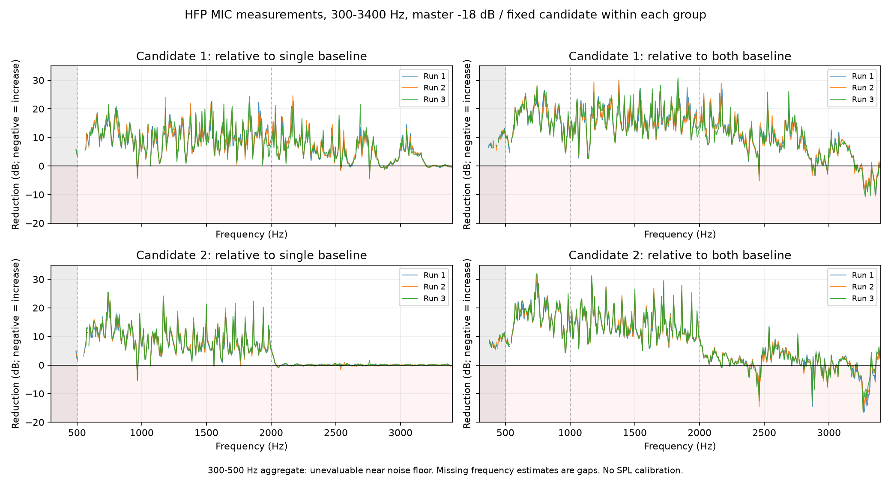

# 広帯域FIRのWi-Fi実機検証（2026-11-07）

ユーザーの依頼に従い、指示書7章のアプリ操作をWi-Fi ADBで実行しました。現在の設置で伝達特性を測定し、集約候補を作成して3回比較しました。その結果を受け、同じ設置で再測定・再設計した別候補についても3回比較しています。伝達特性の測定は2回、作成した候補は2件です。6回の比較は内部3ラウンドずつ、計18ラウンドが正常完了しました。

## 条件と操作範囲

実機はXQ-FS44です。導入済みdebug APKを端末から取得し、検証済みAPKとのSHA-256一致を確認しました。versionNameは`0.1.0`、versionCodeは`1`、SHA-256は`5c481fe83f7f54a79cf171b2eeb88e0423023cbdedf0e1d2f85463e6c0c4014f`です。実装コミットは`e050e3cfee4c42bcc8f7a5a0e054fe083f928e7e`、検証開始時HEADは`af5be5fab0af2f1bc9d18fbc0f3a4ee09bcada7c`でした。この検証ではアプリコードや判定条件を変更していません。

ユーザーがセッティング済みとした条件で実施しました。通常の横置き、音声Lが物理左、音声Rが物理右という既存設定を維持し、左右をそれぞれ短時間再生して確認操作を確定しています。物理的な位置関係や聞こえ方をCodexが独立に確認したものではありません。距離・高さ・壁や机との関係・設置写真は未取得です。

| 項目 | 実施条件 |
|---|---|
| 出力／入力 | 本体SP（type=2）／Bluetooth HFP MIC（type=7）。全測定の要求と実ルートをJSONで照合 |
| PCM | 出力48,000 Hz stereo float／入力48,000 Hz mono PCM16。HFP無線codecは不明 |
| 録音プリセット | VOICE_COMMUNICATION（7） |
| 入力処理 | AGC API非対応。NS・AECはAPI上で無効化。MIC内部処理は不明 |
| 音量 | 開始時の共通出力−18 dBを維持。全測定のsystemVolumeIndex=29 |
| 帯域 | 測定・設計・比較とも300〜3,400 Hz |
| 設計 | 2反復の集約、1,025 taps、正則化0.01、最大ブースト6 dB、左基準・右補正 |
| 伝達測定信号 | SWEEP、各3秒、残響保持0.5秒、同期探索余裕1.5秒 |

比較では既存の補正を重ねず、片側基準・無補正両側・候補を独立に測定しました。両方の元診断は正式自動設計の品質条件を満たさず、正式補正の自動反映はありません。実験候補の手動適用や聴感判定も行っていません。

## 候補と元診断

| 候補 | ID | 元診断の試験用有効率 | 同期残差（48 kHz sample） | 全帯域予測 片側／両側 dB |
|---|---|---:|---:|---|
| 1 | `cae34bb91b6a53d07048aac6` | 72.40% | 1.286249 | 6.43〜6.44／10.93〜10.96 |
| 2 | `7085475b8e7b33caac6c293e` | 47.45% | 1.194791 | 3.28〜3.29／7.89〜8.65 |

両診断とも`BAND_QUALITY`で正式反映は未成立です。同期には`LEGACY_SYNC_RESIDUAL`の警告が残ります。候補比較の結果を正式合格に読み替えていません。

- 候補1の係数SHA-256: `d0f6d2a9ce87c5246d7d04f422d19cdbe2a74078c12e108fc5b41e373b788b22`
- 候補1の入力診断SHA-256: `594cdb827b07ba4b5741816be8010616249d02fc3f3c99c37f21a5a422b5a00c`
- 候補2の係数SHA-256: `886d9a04fa1447086117c175a49619899209c04674bb628ea84bd803c91e204b`
- 候補2の入力診断SHA-256: `9b3ca4924b7104f237be88bf69b8faffe5c7b3516c928d8e29b30d3b42fdd476`

## 全帯域の実測結果

値はMIC録音上の相対電力です。片側比は左だけを鳴らした基準、両側比は無補正で両側を鳴らした基準との比較です。正値は低減、負値は増音を表します。校正SPLや耳位置の音量ではありません。

| 候補・実行 | 開始時刻 JST | 片側比 dB | 片側下限 dB | 両側比 dB | 両側下限 dB | 基準変動 dB | 候補ばらつき dB | 判定 |
|---|---|---:|---:|---:|---:|---:|---:|---|
| 1・1 | 22:14:39 | 5.64 | 5.39 | 10.69 | 10.48 | 0.060 | 0.187 | `REDUCTION_OBSERVED` |
| 1・2 | 22:18:11 | 5.75 | 5.54 | 10.80 | 10.62 | 0.050 | 0.089 | `REDUCTION_OBSERVED` |
| 1・3 | 22:21:36 | 5.59 | 5.37 | 10.64 | 10.46 | 0.049 | 0.058 | `REDUCTION_OBSERVED` |
| 2・1 | 22:30:18 | 2.98 | 2.79 | 7.55 | 7.40 | 0.043 | 0.138 | `INSUFFICIENT_REDUCTION` |
| 2・2 | 22:33:37 | 3.08 | 2.93 | 7.70 | 7.58 | 0.076 | 0.076 | `INSUFFICIENT_REDUCTION` |
| 2・3 | 22:36:36 | 3.09 | 2.96 | 7.72 | 7.62 | 0.058 | 0.022 | `INSUFFICIENT_REDUCTION` |

候補1の3実行は片側比5.59〜5.75 dB、両側比10.64〜10.80 dBでした。実行間の最大差は片側比0.162 dB、両側比0.163 dBです。
候補2の3実行は片側比2.98〜3.09 dB、両側比7.55〜7.72 dBでした。実行間の最大差は片側比0.118 dB、両側比0.167 dBです。

## サブバンドと周波数ごとの違い

| 候補・実行 | 300〜500 Hz | 500〜1,000 Hz | 1,000〜2,000 Hz | 2,000〜3,400 Hz |
|---|---|---|---|---|
| 1・1 | 評価不能 | 9.44／15.54 | 8.78／14.87 | 3.33／6.42 |
| 1・2 | 評価不能 | 9.78／15.83 | 8.70／14.83 | 3.46／6.53 |
| 1・3 | 評価不能 | ≥9.17／≥15.18 | 8.52／14.87 | 3.32／6.34 |
| 2・1 | 評価不能 | ≥9.19／≥15.39 | 6.62／12.38 | 0.13／1.59 |
| 2・2 | 評価不能 | 10.08／16.12 | 6.58／12.37 | 0.14／1.66 |
| 2・3 | 評価不能 | 10.19／16.23 | 6.67／12.48 | 0.13／1.65 |

各欄は片側比／両側比のdBです。`≥`はノイズ床に近いため保守的下限を示します。300〜500 Hzでは基準がノイズ床付近となり、帯域としての低減量は評価できません。未評価を0 dBや成功値で補っていません。

全帯域の低減があっても、周波数単位では増音が残ります。次表は低SNRを含め、評価値が存在する全ビンの最小値です。局所値だけで全帯域の効果を置き換えず、欠落値・低SNR・設計対象外フラグもCSVへ保存しました。

| 候補・実行 | 片側比の最小値 dB（Hz） | 両側比の最小値 dB（Hz） | 約931.64 Hz 片側／両側 dB |
|---|---|---|---|
| 1・1 | -4.26（966.80） | -9.74（3363.28） | 8.68／14.06 |
| 1・2 | -4.22（966.80） | -8.92（3357.42） | 9.12／14.54 |
| 1・3 | -4.51（2759.77） | -10.79（3281.25） | 9.75／15.05 |
| 2・1 | -4.86（966.80） | -16.64（3269.53） | 11.62／17.39 |
| 2・2 | -5.11（966.80） | -15.53（3263.67） | 11.80／17.61 |
| 2・3 | -5.37（966.80） | -16.21（3263.67） | 11.57／17.35 |



## 再設計と読込上限

最初の候補では、経路を開き直した3実行すべてで両基準比の保守的下限が3 dBを超えました。そこで7章Dの分岐に従い、同じ条件で新しく測定・設計しました。設計に使えるビンは383から251へ減り、全帯域予測も低下しています。再設計した候補の結果は別群として扱っています。同じ候補を繰り返し測ったときの再現性と、毎回の測定・設計で同程度の候補を得られることは別の課題です。

2回目の元診断は、比較履歴を含む`originalSession`と整形用の空白によって22,097,556文字になり、「最新の診断結果を選択」で16,000,000文字の読込上限に達しました。元JSONを保存したまま、文字列外の空白だけを除いた11,508,131文字の別ファイルを作り、通常の「保存診断／候補JSONを読込」で読み込んでいます。数値・文字列トークンを保持し、JSONとして全項目が等しいことを確認しました。元診断の内容や品質閾値、帯域を変更したものではありません。

元の`measurement2.json`のSHA-256は`4cc35c334f4a607b7f474f7deb5a41c390b5e00d17cf4995ccfcb59963fe22cb`、空白除去版のSHA-256は`9b3ca4924b7104f237be88bf69b8faffe5c7b3516c928d8e29b30d3b42fdd476`です。候補2のsourceHashは空白除去版に対応します。読込上限による操作停止は今回の検証で見つかった未修正の問題です。

## 成果物と追跡方法

[検証用GitHub Release](https://github.com/hebowiz/SpeakerArray/releases/tag/wideband-validation-20261107)に、元診断2件と空白除去版、候補2件、各比較後のJSON6件、画面記録、集計スクリプト、報告書・CSV・図をまとめたZIP、および検証対象debug APKとテストAPKを掲載します。今回の成果物をすべてGitHubへ上げるという追加依頼に従い、診断JSONとAPKもReleaseへ含めます。LAN接続情報、端末設定の全体ダンプ、他アプリの情報を含む操作ログは公開対象から除きます。

`compare1.json`〜`compare5.json`はGUIからの保存原本です。`compare6.json`は後述の復元版で、GUI保存成功の証拠ではありません。[ファイル名・サイズ・SHA-256・取得方法の一覧](analysis/wideband-live-artifacts.json)で区別しています。端末のDownloadsにも保存し、復元版だけは`SpeakerArray-wideband-live-compare6-recovered.json`という名前にしました。

[全帯域・サブバンド比較CSV](analysis/wideband-live-comparisons.csv)、[サブバンド詳細CSV](analysis/wideband-live-subbands.csv)、[周波数別CSV](analysis/wideband-live-frequencies.csv)、[候補対応CSV](analysis/wideband-live-candidates.csv)をリポジトリに保存しました。比較JSONは累積履歴を含むため、集計では実行IDで重複を除きます。

| 候補・実行 | 実行ID | 保存ファイル |
|---|---|---|
| 1・1 | `422a7507-14d0-4710-963d-6b9c6e5c019e` | `compare1.json` |
| 1・2 | `6e36cadb-3dd6-46f9-9a2f-c0a208a497e6` | `compare2.json` |
| 1・3 | `3015b35d-bce5-4f24-b59f-55d12b214bb1` | `compare3.json` |
| 2・1 | `d78a4b52-3145-4d56-b6c7-c6155dc8a1f0` | `compare4.json` |
| 2・2 | `9fa31b4a-c98e-4089-a4be-53b772db384c` | `compare5.json` |
| 2・3 | `a79511de-0eff-4c03-99ad-b6de7a5fd473` | `compare6.json` |

```powershell
python tools/summarize_comparisons.py docs/analysis/wideband-live-comparisons.csv build/wideband-live-audit/compare1.json build/wideband-live-audit/compare2.json build/wideband-live-audit/compare3.json build/wideband-live-audit/compare4.json build/wideband-live-audit/compare5.json build/wideband-live-audit/compare6.json
python build/wideband-live-audit/export_results.py
```

図の再生成にはmatplotlibが必要です。端末操作を自動再実行するコマンドは含めていません。元診断と候補の内容、実行ID、係数ハッシュ、帯域・音量・ルートを保って検証しました。

## 最後のJSON保存失敗と復元

候補2の3回目の比較後、「候補・結果を保存」で「保存しました」と表示されましたが、端末上のファイルは0バイトでした。通常保存を再試行し、さらに比較履歴の退避も試しましたが、計3ファイルがすべて0バイトでした。保存操作後に再生画面へ戻る現象も観測しました。取得したログでは今回のクラッシュやプロセス終了を確認できず、原因は未確定です。

アプリの保存済みセッションには3件とも残っていました。ADBで読み出した最新の候補を、既存の候補エクスポート形式で包んで`compare6.json`を復元しました。保存失敗前の候補データとの完全一致、先行2比較と`compare5.json`の一致、元候補の係数・設計情報の一致をJSONの全項目で確認しています。数値を補間したり、測定をやり直したりしていません。

復元版のSHA-256は`f0388123bc83a2e0658d253139b9652939498306730a4942b27db52250a76d03`です。端末へ転送した後も同じSHA-256を確認しました。ZIP内の`compare6-recovery.json`に取得方法と照合内容を、`compare6-failed-empty.json`に最初の空ファイルを残しています。履歴整理は実行せず、端末内の比較履歴も保持しました。

通常保存の本文は`AppUi.kt`の`remember`状態に置かれています。SAF画面を往復する際の状態保持と、空本文を保存成功として扱う処理は修正候補です。ただし、今回の原因がActivity再生成だとは断定できません。容量上限による読込失敗と、この保存失敗はどちらも未修正です。

## 終了状態と次の確認

終了時は再生・録音とも停止しています。開始前と終了後の保存セッションを照合し、`experiments`以外の全項目が一致しました。既存の候補3件、適用中のFIR、元に戻すための設定も一致しています。実験欄には新しい候補2件と比較結果を残し、候補2を選択した状態です。WHITE音源、共通出力−18 dB、左右割当、単純補正、A/B、FIR処理設定を保持しました。

候補1では両基準比の保守的下限が3 dBを超えました。候補2では片側比の下限が2.79〜2.96 dBにとどまり、3回とも効果不足の判定でした。同じ候補を再接続して測る再現性は確認できましたが、測定・設計からやり直して同等の効果を得る再現性は確認できていません。両候補とも`formalAccepted=false`です。

次は保存・読込処理を修正したうえで、再測定によって有効ビンと高域側の効果が変わった原因を調べます。HFP内部処理、反復位相、品質マスクと予測の変化を比較し、必要なら帯域限定試験を別条件で計画します。今回は要求帯域を縮めず、300〜500 Hzの評価不能と局所的な増音を残して終了しました。
